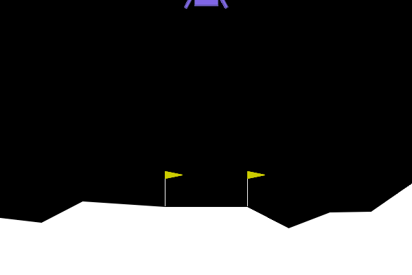
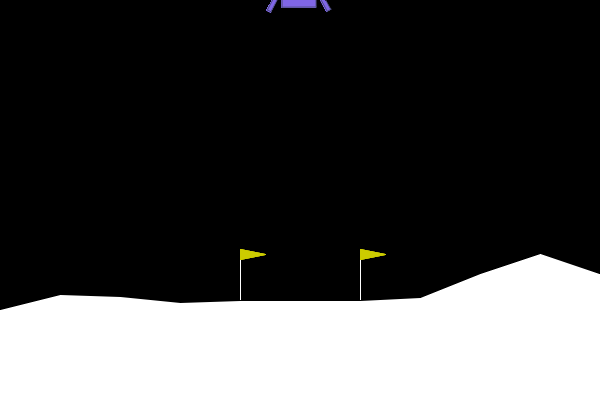

Markdown · README.md

# Reward Design in LunarLander-v3 with PPO

## Overview

This project trains a PPO agent on Gymnasium's LunarLander-v3, then changes the reward to see how the agent's behaviour changes. It has a baseline, a reward wrapper for smoother control, a reward I designed to fail, a fix, and a comparison of all three.

## Repository contents

```
README.md
requirements.txt
notebooks/
  lunarlander-ppo-baseline.ipynb   # trains and tests 5 baseline agents
  lunarlander-ppo-reward.ipynb     # reward wrapper, broken and fixed agents, comparison
results/
  baseline/                        # test results from the baseline notebook
  reward_experiments/              # test results from the reward notebook
media/                             # GIFs
```

The reward wrapper is the `Smooth` class in `lunarlander-ppo-reward.ipynb`.

## Setup and how to run

I ran everything on Kaggle using a CPU session.

1. Import `lunarlander-ppo-baseline.ipynb` into Kaggle (File > Import Notebook), set the accelerator to None (CPU), and turn Internet on.
2. Run all cells. The first cell installs the packages. Training the 5 baseline agents takes about 20 minutes each.
3. Import `lunarlander-ppo-reward.ipynb` the same way, and add the output of the baseline notebook as an input. Run it with Save Version > Save & Run All. Training the three new agents takes about 70 minutes.

To run the notebooks outside Kaggle, install the packages with `pip install -r requirements.txt` and change the folder paths at the top of each notebook from `/kaggle/working/...` to a local folder.

## Settings

All agents use the same settings, so the only difference between them is the reward.

| Setting | Value |
| --- | --- |
| Algorithm | PPO (Stable-Baselines3), `MlpPolicy`, CPU |
| Training steps | 1,000,000 per agent, 16 parallel games |
| n_steps / batch_size / n_epochs | 1024 / 64 / 4 |
| gamma / gae_lambda / ent_coef | 0.999 / 0.98 / 0.01 |

The hyperparameters come from the [RL Baselines3 Zoo](https://github.com/DLR-RM/rl-baselines3-zoo) settings for LunarLander, as listed on the [sb3 model card](https://huggingface.co/sb3/ppo-LunarLander-v2).

I tested every agent on the same 100 games (seeds 1000 to 1099) and scored them all on the original game reward, without my bonus or penalty. A game counts as a success if it scores 200 or more. I also recorded whether each game ended in a landing, a crash or a timeout (1000 steps).

## 1. Baseline

I trained 5 baseline agents with seeds 0 to 4.

| Seed | Mean | Std | Min | Max | Success % | Timeout % | Avg steps |
| --- | --- | --- | --- | --- | --- | --- | --- |
| 0 | 260.3 | 25.9 | 97.5 | 306.4 | 99 | 1 | 315.9 |
| 1 | 255.2 | 20.2 | 209.6 | 294.0 | 100 | 0 | 365.4 |
| 2 | 254.5 | 20.0 | 206.9 | 298.7 | 100 | 0 | 355.9 |
| 3 | 267.3 | 19.6 | 218.1 | 308.2 | 100 | 0 | 285.4 |
| 4 | 262.3 | 20.6 | 214.9 | 300.1 | 100 | 0 | 303.2 |

The 5 seeds average 259.9, with a standard deviation of 5.3 between them. 499 of 500 games scored above 200 and none crashed. The one failure (seed 0, score 97.5) did not finish before the 1000-step limit.

## 2. My reward change

I chose to work on smooth control, which means the lander changes between its engines less often while it flies and lands.

This matters outside the game too. On a spacecraft or drone, switching thrusters on and off quickly wears out the hardware, wastes fuel and shakes the vehicle. LunarLander can't measure those, so I use how often the agent switches engines instead.

When I watched the baseline GIF, the lander wobbled between left and right and shook when it touched the ground. Over 30 games (seed 1), it changed its button on 62% of steps (228 out of 368). The default reward charges for using the engines, but it has no cost for switching between them, so the agent has no reason to switch less.

I want the agent to switch between the left and right engines less, so the lander tilts less, comes down straighter and does not jitter when it touches the ground. To do this, I subtract 0.05 each time it switches directly from the left engine to the right engine, or the other way round. I did not penalise other switches, like turning the main engine on and off, because the agent needs those to land.

The agent could get around this rule by pressing "do nothing" between a left and a right. To check for this, I also count left-right changes that have other buttons in between (`lr_flips`).

## 3. The broken reward

For the broken reward, which I call `hold_bonus`, I give +0.5 on every step where the agent presses the same button as the step before. Repeating a button means not switching, so this looks like it should lead to fewer switches.

The problem is that the bonus is paid on every step until the game ends, and landing ends the game. The engine costs are too small to cancel it out. Holding the main engine gains +0.2 per step (0.5 - 0.3) and holding a side engine gains +0.47 (0.5 - 0.03). So the agent earns more the longer it keeps the game going. The default reward doesn't have this problem, because it pays for getting closer to the pad, and moving away takes those points back.

## 4. The fix

I fixed this by replacing the per-step bonus with the left-right penalty from section 2. A penalty only takes points away, so dragging the game out never earns anything extra. I trained the fixed reward with 2 seeds (0 and 1).

This is also why I scored every agent on the original reward. In game 27, the broken agent never finished and scored 98. With its bonus counted, that game could have scored up to 500 more and looked better than a normal baseline landing.

## 5. Results

These are the results over the same 100 test games.

| Agent | Mean | Std | Success % | Landed % | Crash % | Timeout % | Avg steps |
| --- | --- | --- | --- | --- | --- | --- | --- |
| Baseline (seed 1) | 255.2 | 20.2 | 100 | 100 | 0 | 0 | 365.4 |
| Broken (seed 0) | 244.2 | 35.7 | 96 | 97 | 1 | 2 | 383.3 |
| Fixed (seed 0) | 252.8 | 30.7 | 98 | 99 | 1 | 0 | 336.7 |
| Fixed (seed 1) | 257.4 | 19.5 | 100 | 100 | 0 | 0 | 358.7 |

I also measured how each agent flies over 30 games.

| Agent | Steps | Engine steps | Switches | LR flips | Mean tilt |
| --- | --- | --- | --- | --- | --- |
| Baseline (seed 1) | 368 | 243 | 228 | 44 | 0.06 |
| Broken (seed 0) | 391 | 332 | 246 | 103 | 0.05 |
| Fixed (seed 0) | 343 | 219 | 202 | 33 | 0.07 |
| Fixed (seed 1) | 360 | 205 | 217 | 14 | 0.06 |

### The broken agent

The broken agent took a little longer than the baseline (383 steps against 365), switched buttons slightly more (246 against 228), more than doubled its left-right flips (44 to 103), and fired an engine on 85% of steps instead of 66%. Because the bonus made holding an engine pay, it fired more and wobbled more. Its scores also varied more (std 35.7 against 20.2).

The clearest failures were 2 timeouts (games 27 and 65) and 1 crash (game 58). The GIF below shows game 27. The lander touches down at the edge of the pad but keeps firing a side engine, so it never comes to rest and the game never counts as a landing. It ran for the full 1000 steps and scored 98.



### The fixed agents

Both fixed agents had fewer left-right flips than the baseline (33 and 14 against 44) and used the engines less, while scoring about the same. They did not get around the rule, because `lr_flips` also counts left-right changes with other buttons in between. Tilt stayed about the same (0.06 against 0.07 and 0.06), so that part of my goal was not met. The two seeds disagree on how big the effect is, and seed 0 had one crash, so the size of the improvement is not certain.



## Limitations

The broken reward was trained on only 1 seed and the fixed reward on 2, so more seeds would make the comparison stronger. I compared against one baseline seed (seed 1). I also tested only one penalty size (0.05) and one bonus size (0.5). Some switching is needed to fly this lander, so a lower switch count is only better up to a point.

## What I learned

**Main lesson:** the agent only follows what the reward pays for. The hold bonus was meant to reduce switching, but the agent learned to touch down and keep firing a side engine so the game would not end. A new reward term has to be checked against the rewards already in the game. Scoring every agent on the original reward and measuring how each one flies is what showed me the failure.

**One thing I would improve:** I would test several penalty sizes (for example 0.01, 0.05, 0.2 and 0.5) to find where smoother control starts to hurt landing.

**One question I still have:** would the left-right penalty still help with wind turned on, or would the agent need the quick corrections the penalty discourages?

**What I would test next:** I would try a penalty that also catches left-right changes with other buttons in between (such as left, do nothing, right), to close the loophole in my rule.

## GenAI use

This was my first reinforcement learning project. I learned the RL concepts from the Gymnasium and Stable-Baselines3 documentation, the Hugging Face Deep RL course and OpenAI's Spinning Up. I used Claude to help write and review the training, evaluation and wrapper code, and to break down concepts further when I got stuck. I chose the reward angle and the left-right rule from my own observations of the baseline, and ran all the experiments myself.